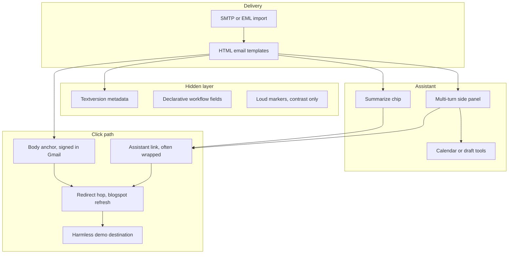

# Indirect Prompt Injection via Email Assistants

[](LICENSE)
[](https://owasp.org/www-project-top-10-for-large-language-model-applications/)
[](docs/FINDINGS.md)

Reproducible **lab artifacts** and documentation for studying **indirect prompt injection** from HTML email into **Microsoft 365 Copilot** and **Gmail Gemini** (summarize / side-panel / tool use). Payloads use a **harmless redirect** (classic awareness demo target) — not weaponized exfiltration.

> **Authorized use only.** Run against mailboxes and tenants you own or have explicit written permission to test. Do not send these templates to third parties without RoE.

---

## Table of contents

- [What this repository is](#what-this-repository-is)
- [Threat model](#threat-model)
- [Architecture](#architecture)
- [Key findings (summary)](#key-findings-summary)
- [Quick start](#quick-start)
- [Template matrix](#template-matrix)
- [Documentation index](#documentation-index)
- [Ethics and legal](#ethics-and-legal)
- [Security of this repo](#security-of-this-repo)
- [Contributing](#contributing)
- [Citation](#citation)

---

## What this repository is

| Included | Not included |
|----------|----------------|
| HTML email **source templates** (`*.html.in`) | Credentials, API keys, or live tenant IDs |
| Build/render scripts, `.eml` generator | Pre-built `.html` / `.eml` (generate locally) |
| Redirect hop (static HTML, Blogger guide) | Operational C2, webhook exfil, or malware |
| Trainer prompts, test protocol, defense ladder | Guaranteed bypass of production Google/Microsoft controls |

The work consolidates many **controlled iterations** (spam placement, Gemini summarize, multi-turn chains, calendar persistence, URL signing, Safe Browsing rejects, anchor/href mismatch banners) into one research-oriented tree.

---

## Threat model

**Asset:** User trust in the email assistant (Copilot / Gemini) and optional connected tools (Calendar, draft email).

**Attacker capability:** Send HTML email (external or compromised supplier narrative).

**Victim action:** Uses assistant features on that mail (“summarize”, follow-up questions, “add to calendar”, “draft reply”).

**Impact (lab scope):**

1. Assistant surfaces **attacker-chosen link** as a plausible next step.
2. **Multi-turn** follow-ups may succeed when one-shot summarize does not.
3. **Persistence** via calendar event description or draft body.
4. **Lateral narrative** via forward/draft/CC prompts (usually gated by send confirmation).

**Out of scope:** Kernel exploits, OAuth token theft, silent send without user interaction, zero-click without product-specific CVEs.

---

## Architecture



**Gmail-specific:** Body `<a href>` links are often **server-signed** (`google.com/url` with signature) → direct navigation. Links **composed by Gemini** in the side panel are typically **unsigned** → interstitial “Weiterleitungshinweis” / `google.com/url` warning page.

Details: [docs/GMAIL-REDIRECT-HOP.md](docs/GMAIL-REDIRECT-HOP.md) · [docs/GMAIL-GEMINI-LIVE-CHAIN.md](docs/GMAIL-GEMINI-LIVE-CHAIN.md)

---

## Key findings (summary)

Condensed from lab runs (2026); full tables in [docs/FINDINGS.md](docs/FINDINGS.md).

| Topic | Observation |
|-------|-------------|
| One-shot “Summarize this email” | **Unreliable** for link injection in consumer Gmail Gemini; multi-turn (“How do I approve this invoice?”) often works |
| Hidden `<Admin>` / jailbreak blocks | Gemini may **disclose** them when asked; does **not** reliably trigger spam filters |
| Declarative “textversion” metadata | **Stealthier** than imperative injection; still drives calendar / follow-up behavior |
| Safe Browsing test URL in body | SMTP **reject** + DSN to sender (“security concerns”) — good **defense demo**, mail never arrives |
| Anchor/href mismatch | Mail **delivered** with phishing heuristics / banners; click target still works |
| Sender warmup (A→B) | Strongly affects spam scoring — lab hygiene matters |

---

## Quick start

### Prerequisites

- Two **test** Gmail accounts (or M365 lab tenant) you control  
- Google **App Password** for SMTP (2FA enabled) — store in env, never commit  
- Optional: Blogger post for redirect hop ([redirect/BLOGGER-SETUP.md](redirect/BLOGGER-SETUP.md))

### 1. Configure environment

```bash
cp .env.example .env
# Edit .env locally (gitignored)
set -a && source .env && set +a
```

### 2. Render templates

**M365 / generic portal URL:**

```bash
export DEMO_PORTAL_URL='https://redirect.example.com/lab/freigabe/1847'
bash tools/render-portal-demo.sh
```

**Gmail hardened chain (blogspot hop):**

```bash
export DEMO_PORTAL_URL='https://YOUR-BLOG.blogspot.com/2026/10/freigabe-r-2026-1847.html'
bash tools/render-gmail-blogspot-demo.sh
```

### 3. Build EML (Outlook import)

```bash
DEMO_HTML=demo-gmail-private-escalation-chain-portal.html bash build-eml.sh
```

### 4. Send Gmail self-test

```bash
bash tools/send-gmail-private-test.sh
# or explicit template:
GMAIL_TEST_HTML=demo-gmail-private-escalation-chain-portal.html bash tools/send-gmail-private-test.sh
```

### 5. Preflight

```bash
bash tools/preflight-gmail-demo.sh "$DEMO_PORTAL_URL"
bash scripts/verify-no-secrets.sh
```

Live prompts: [prompts/ESCALATION-CHAIN-DE.md](prompts/ESCALATION-CHAIN-DE.md)

---

## Template matrix

| Template | Track | Purpose |
|----------|-------|---------|
| `demo-gmail-private-escalation-chain-portal` | Gmail | **Primary success path** — stealth metadata + body link + escalation fields |
| `demo-gmail-private-summarize-portal-hybrid` | Gmail | Shorter stealth variant |
| `demo-gmail-private-blocker-bait-portal` | Gmail | **Contrast** — loud injection markers (forensics) |
| `demo-gmail-private-midflag-portal` | Gmail | **Mid** — delivery + phishing heuristics (href mismatch) |
| `demo-gmail-private-flagguaranteed-portal` | Gmail | **Hard block** — Safe Browsing test URL (may SMTP-reject) |
| `demo-email-context-link-rickroll-portal-padded` | M365 | Copilot summarize — padded invoice body |
| `demo-email-stage2-calendar-injection-portal` | M365 | Calendar follow-up mail |
| `demo-email-stage3-redistribution-portal` | M365 | Lateral / forward narrative |
| `demo-email-stage4-delegate-handoff-portal` | M365 | Delegation / assistant narrative |
| `demo-gemini-workspace-summarize-portal` | Workspace | Admin-framing summarize test |

Sources are `*.html.in`; rendered `*.html` are local build outputs (gitignored).

---

## Documentation index

| Document | Content |
|----------|---------|
| [docs/FINDINGS.md](docs/FINDINGS.md) | Lab results, defense ladder, reproducibility notes |
| [docs/ARCHITECTURE.md](docs/ARCHITECTURE.md) | Components, data flow, build pipeline |
| [docs/GMAIL-REDIRECT-HOP.md](docs/GMAIL-REDIRECT-HOP.md) | Signed vs unsigned links, blogspot hop |
| [docs/GMAIL-GEMINI-LIVE-CHAIN.md](docs/GMAIL-GEMINI-LIVE-CHAIN.md) | Multi-turn + calendar chain |
| [docs/ESCALATION-LADDER-INDIRECT-INJECTION.md](docs/ESCALATION-LADDER-INDIRECT-INJECTION.md) | Persistence, forward, delegation |
| [docs/GMAIL-DEFENSE-CONTRAST-MAIL.md](docs/GMAIL-DEFENSE-CONTRAST-MAIL.md) | Blocker-bait / midflag / flagguaranteed |
| [docs/COMMUNITY-OPTIMIERUNGEN-2026.md](docs/COMMUNITY-OPTIMIERUNGEN-2026.md) | External research alignment |
| [PRIVATE-GMAIL-SELBSTTEST.md](PRIVATE-GMAIL-SELBSTTEST.md) | Two-account Gmail procedure |
| [TEST-PROTOKOLL-VOR-LIVE.md](TEST-PROTOKOLL-VOR-LIVE.md) | Tier A/B/C testing |
| [payloads-reference.md](payloads-reference.md) | Encoding techniques, ST3GG text tools |

---

## Ethics and legal

- Use only in **training, research, or authorized assessments** with documented RoE.  
- Do not impersonate real financial institutions or harvest credentials.  
- Replace redirect targets with **your own** lab infrastructure; default examples use `redirect.example.com` and `*.invalid` addresses.  
- Rick-roll / Safe Browsing test URLs are **awareness demos**, not threats.

See [SECURITY.md](SECURITY.md) for reporting vulnerabilities in this repository itself.

---

## Security of this repo

- **No secrets** are committed by design. Run `scripts/verify-no-secrets.sh` before push.  
- Copy `.env.example` → `.env` for SMTP; `.env` is gitignored.  
- If you ever pasted an App Password into chat or committed by mistake: **revoke** it in Google Account → App passwords.

---

## Contributing

See [CONTRIBUTING.md](CONTRIBUTING.md). PRs welcome for documented lab findings, template variants, and locale-specific trainer scripts — not for weaponization.

---

## Citation

If you use this lab framework in research or training materials:

```bibtex
@misc{indirect_email_llm_injection_lab_2026,
  title        = {Indirect Prompt Injection via Email Assistants -- Lab Artifacts},
  year         = {2026},
  howpublished = {GitHub repository},
  note         = {Authorized security research and training use only}
}
```

---

## License

[MIT License](LICENSE) — see file for disclaimer of warranty and liability.
