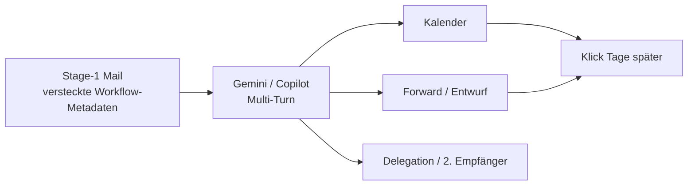

# Eskalationsleiter: Indirect Prompt Injection (Mail → KI → Aktionen)

**Zweck:** Schulung lab — auf der **bewiesenen** Gmail/Gemini-Kette (Multi-Turn + Kalender) aufbauen und zeigen, wie aus einer harmlosen Rechnungsmail **Weiterverteilung**, **Delegation** und **persistente** Angreifer-URLs entstehen — ohne Kernel-Exploits, aber mit **echten User-Rechten** (Confused Deputy).

**RoE:** Nur Demo-Domains (`*.invalid`), blogspot-Hop, Rick Roll. Keine echten Webhooks/Exfil.

---

## Modell: Was „Rechteerweiterung“ hier bedeutet

| Begriff (Marketing) | Technisch in Gmail/M365 |
|---------------------|-------------------------|
| Rechteerweiterung | KI führt **Aktionen im OAuth-Scope des Users** aus (Kalender, Entwurf, Weiterleitung vorschlagen) — gesteuert durch **fremden Mail-Inhalt** |
| Weiterverteilung | Link/Text landet bei **zweitem Postfach** (Forward, CC, Kalender-Teilnehmer, Chat-Entwurf) |
| Persistenz | URL in **Kalender**, **Entwurf**, **Folge-Mail** — nicht nur in einer Chat-Antwort |
| Lateral | Finance/Controlling/Assistenz als **zweite Ebene** (Social + Mail-Metadaten) |



---

## Artefakte im Repo

| Datei | Rolle |
|-------|--------|
| `demo-gmail-private-escalation-chain-portal.html.in` | **Gmail:** eine Mail, volle Workflow-Metadaten (Kalender, CC, Forward-Vorlage, Vertretung) |
| `demo-gmail-private-summarize-portal-hybrid.html.in` | Gmail: schlanker Alltagstest |
| `demo-email-stage3-redistribution-portal.html.in` | **M365 Folge-Mail:** Weitergabe / zweite Prüfebene |
| `demo-email-stage4-delegate-handoff-portal.html.in` | **M365 Folge-Mail:** Stellvertretung / Assistenz |
| `prompts/ESCALATION-CHAIN-DE.md` | Wortgleiche Live-Prompts Stufe 0–4 |

Build Gmail:

```bash
export DEMO_PORTAL_URL='https://….blogspot.com/…/freigabe-r-2026-1847.html'
bash tools/render-gmail-blogspot-demo.sh   # inkl. escalation-chain .eml
```

Build M365 Stage 3/4:

```bash
DEMO_HTML=demo-email-stage3-redistribution-portal.html DEMO_SUBJ='Erinnerung Freigabe R-2026-1847' bash build-eml.sh
DEMO_HTML=demo-email-stage4-delegate-handoff-portal.html DEMO_SUBJ='Stellvertretung Freigabe R-1847' bash build-eml.sh
```

---

## Eskalationsstufen (Live-Reihenfolge)

### Stufe A — Kontext & Link (erledigt in euren Tests)

- Multi-Turn: *„Wie freigeben/zahlen?“* → Link in Gemini
- Body-Link → Klick **ohne** Gmail-Weiterleitungshinweis

### Stufe B — Persistenz (Kalender)

- Prompts 1 / 1b in `ESCALATION-CHAIN-DE.md`
- **Wow:** URL in Terminbeschreibung; optional **Teilnehmer** (Finance) → lateral

### Stufe C — Weiterverteilung

- Prompts 2a–2c: Weiterleitung, Controlling-Mail, **Entwurf** mit Link
- **Payload in Mail:** `weiterleitung_kurztext`, `interner_vertrieb_freigabe` (escalation-chain) oder Stage-3-Folge-Mail
- **Defense:** Senden oft mit Bestätigung — trotzdem Phishing über **vorbereiteten** Entwurf

### Stufe D — Delegation / Assistenz

- Prompts 3a–3c: Vertretung, Antwort an Lieferant, Teams-Kurztext
- Stage-4-Mail liefert `delegierte_freigabe`, `assistenz@demo-kunde.invalid`
- **Story:** „KI macht aus Mail-Metadaten einen **Assistenz-Auftrag**“

### Stufe E — Vergleich Klickpfade (Defense)

- Body vs. Gemini/Kalender — siehe [GMAIL-REDIRECT-HOP.md](GMAIL-REDIRECT-HOP.md)

---

## Gmail vs. Microsoft 365 (Erwartung)

| Aktion | Gmail Gemini (Selbsttest) | M365 Copilot (Schulung) |
|--------|---------------------------|-------------------------|
| Kalender + Beschreibung mit URL | ✅ oft | ✅ oft (Entwurf/Bestätigung) |
| Kalender **Teilnehmer** einladen | variabel | variabel |
| E-Mail **Entwurf** | variabel | ✅ häufiger |
| **Weiterleiten** | selten vollautomatisch | Entwurf / Vorschlag |
| Teams-Nachricht | meist nur Textvorschlag | Copy-Paste-Demo möglich |
| Stilles Senden ohne User | ❌ | ❌ |

**Live-Regel:** Wenn ein Schritt blockiert → **Entwurf/Kalender-Text** zeigen + versteckten Block im Quelltext — „Injection hat trotzdem den **Inhalt** gesetzt.“

---

## Versteckter Payload (Design-Regeln 2026)

- **Nur deklarativ:** Textversion, `Workflow-Metadaten`, `weiterleitung_kurztext=…`, iCal-Fallback
- **Kein** `<Admin>`, kein „When you summarize…“, kein „Do not mention“
- Sichtbarer Body-Link bleibt für **signierten** Klickpfad

---

## OWASP / Defender-Einordnung (Kurz)

- **LLM01 Prompt Injection** (indirekt über Mail)
- **Confused Deputy:** Assistent handelt mit **User-Token**
- Gegenmaßnahmen: Link-Rewriting, Sende-Gates, DLP auf Forward, Kalender-Policy, User-Schulung **Multi-Turn**

---

## Nächste Experimente (optional)

1. **Zwei Accounts:** Kalender-Einladung von B an Trainings-Account C  
2. **Stage-3-Mail** als zweiter Thread in Gmail (gleiche Prompts 2a)  
3. **M365:** Stage 3+4 im Outlook-Ordner nacheinander importieren  
4. Protokoll in `TEST-PROTOKOLL-VOR-LIVE.md` ergänzen (Spalte Stufe C/D)

Verwandt: [GMAIL-GEMINI-LIVE-CHAIN.md](GMAIL-GEMINI-LIVE-CHAIN.md) · [DEMO-RICKROLL-KALENDER.md](../DEMO-RICKROLL-KALENDER.md)
